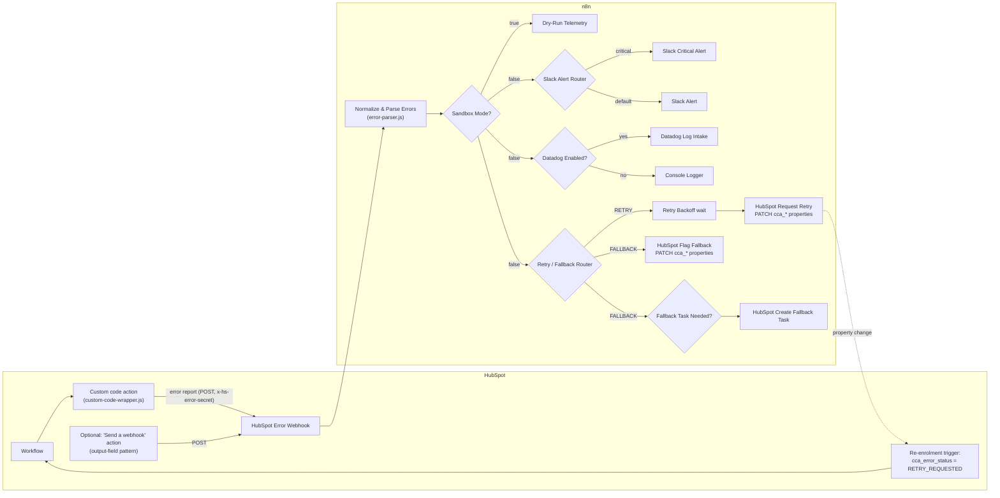

# n8n-hubspot-custom-code-action-error-handler

A centralized error-catching framework for **HubSpot workflow custom code actions**. Every failing action reports to one n8n workflow, which parses the stack trace and HubSpot API error, classifies the failure, alerts Slack (with a separate critical channel), logs to **Datadog** or the console, and triggers an automated **retry** with backoff or a **fallback** (record flag plus a task for RevOps).


> **Safe by default.** With `SANDBOX_MODE=true`, every report is parsed and classified, but alerts, logs and recovery actions are only written to *Dry-Run Telemetry*.

---

## Table of contents

1. [Why this exists](#why-this-exists)
2. [Architecture overview](#architecture-overview)
3. [Error parsing and classification](#error-parsing-and-classification)
4. [Retry and fallback protocol](#retry-and-fallback-protocol)
5. [Repository layout](#repository-layout)
6. [Setup instructions](#setup-instructions)
7. [Webhook configuration in HubSpot](#webhook-configuration-in-hubspot)
8. [n8n deployment](#n8n-deployment)
9. [Environment variable setup](#environment-variable-setup)
10. [Testing](#testing)
11. [Operations and troubleshooting](#operations-and-troubleshooting)
12. [Disclaimer](#️-disclaimer--liability-limitation)
13. [License](#license)

---

## Why this exists

HubSpot custom code actions fail quietly. A failure shows up only in each workflow's action history, nobody is notified, and records simply stop moving through the workflow. Across dozens of workflows, problems such as rate limits, expired tokens, bad property values and code bugs pile up unnoticed.

This framework adds:

- **One place to see every failure**, with the workflow, action, record, HTTP status, HubSpot correlation ID and the exact failed line of code.
- **Consistent, de-duplicated alerting**, so a burst of identical failures produces one Slack message, not a hundred.
- **Machine-readable logs** in Datadog (or stdout) for dashboards and monitors.
- **Automatic recovery** for transient failures, and a clear human handoff for everything else.

---

## Architecture overview



| # | Node | Type | Purpose |
| --- | --- | --- | --- |
| 1 | HubSpot Error Webhook | Webhook | `POST /webhook/hubspot/custom-code-errors`. Responds immediately so the HubSpot action is not slowed down. |
| 2 | Normalize & Parse Errors | Code (`error-parser.js`) | Validates config (fail fast), authenticates `x-hs-error-secret`, parses and classifies each report, de-duplicates alerts and plans recovery. Malformed or unauthenticated reports are dropped and counted, never thrown. |
| 3 | Sandbox Mode? | IF | `SANDBOX_MODE=true` → Dry-Run Telemetry. |
| 4 | Dry-Run Telemetry | Code | Logs every planned alert, log line and recovery action. |
| 5 | Slack Alert Router | Switch | Critical events → *Slack Critical Alert* (if `SLACK_CRITICAL_WEBHOOK_URL` is set); others → *Slack Alert*. Below-threshold or de-duplicated events are not posted. |
| 6–7 | Slack Critical Alert / Slack Alert | HTTP Request | Block Kit message to the Incoming Webhook URL from the environment. |
| 8 | Datadog Enabled? | IF | Routes logs to Datadog or the console. |
| 9 | Datadog Log Intake | HTTP Request (Header Auth `DD-API-KEY`) | `POST https://http-intake.logs.<DATADOG_SITE>/api/v2/logs`. |
| 10 | Console Logger | Code | One structured JSON line per event on n8n's stdout (for Docker, Kubernetes or journald log shipping). |
| 11 | Retry / Fallback Router | Switch | `RETRY`, `FALLBACK`; `NONE` (no record reference or recovery disabled) stops here. |
| 12 | Retry Backoff | Wait | Exponential backoff with jitter before requesting the retry. |
| 13 | HubSpot Request Retry | HTTP Request | `PATCH /crm/v3/objects/{type}/{id}`: `cca_error_status=RETRY_REQUESTED`, `cca_retry_count+1`, last-error details. |
| 14 | HubSpot Flag Fallback | HTTP Request | `PATCH` the record: `cca_error_status=FALLBACK` plus last-error details. |
| 15–16 | Fallback Task Needed? / HubSpot Create Fallback Task | IF / HTTP Request | Creates a diagnostic task on the record for the fallback owner. |

All JavaScript lives in `error-parser.js`. `npm run build` inlines it into the Code nodes of `workflow.json`, so the code that runs in n8n is exactly the code under test. CI fails if they drift. Every HTTP node retries 3 times and continues on error.

---

## Error parsing and classification

`error-parser.js` accepts three payload shapes:

1. **Wrapper reports** from `hubspot/custom-code-wrapper.js`: the full error (`name`, `message`, `stack`, `code`, HTTP `response`), the record, workflow and action identifiers, and the attempt number.
2. **HubSpot "Send a webhook" bodies**: flat fields or `{ "value": … }` properties such as `cca_error_message`, `cca_error_status_code` and `cca_retry_count`.
3. **Batches**: `{ "errors": [ … ] }` or a JSON array (up to `MAX_EVENTS_PER_REQUEST`).

For each report it produces a diagnostic object:

| Field | Source |
| --- | --- |
| `error.failedStep` | First stack frame in **your** code (skips `node_modules`, `node:` internals and anonymous frames), with function, file, line and column |
| `error.stackFrames` | Up to `MAX_STACK_FRAMES` parsed frames, each flagged `internal` or user code |
| `error.statusCode`, `error.code` | HTTP status (axios `response.status`) and Node error code (`ECONNRESET`, …) |
| `error.hubspotCategory`, `error.correlationId`, `error.details` | Parsed from HubSpot API error JSON, even when it is embedded in a message string |
| `error.type`, `severity`, `retryable` | Classification (below) |
| `fingerprint` | Stable 8-character hash of workflow, action, type, normalised message and failed line; groups identical failures across records |
| `source` | Portal, workflow, action and record (`CONTACT`, `0-1` and similar are normalised to `contacts`) |
| `inputFieldNames` | Names only; input values are never forwarded |

| Type | Detected from | Severity | Retryable |
| --- | --- | --- | --- |
| `RATE_LIMIT` | 429, `RATE_LIMITS`, "secondly/daily limit" | warning | ✅ |
| `SERVER` | 5xx | error | ✅ |
| `NETWORK` | `ECONNRESET`, `ENOTFOUND`, "socket hang up" | error | ✅ |
| `TIMEOUT` | "Task timed out after …", `ETIMEDOUT`, `ECONNABORTED`, 408 / 504 | error | ✅ |
| `AUTH` | 401 / 403, `INVALID_AUTHENTICATION`, `MISSING_SCOPES` | **critical** | ❌ |
| `VALIDATION` | 400 / 422, `VALIDATION_ERROR`, "Property values were not valid" | error | ❌ |
| `NOT_FOUND` | 404, `OBJECT_NOT_FOUND` | warning | ❌ |
| `CONFLICT` | 409, "already exists" | warning | ❌ |
| `CODE` | `TypeError`, `ReferenceError`, `SyntaxError`, "is not a function", "cannot read properties" | **critical** | ❌ |
| `UNKNOWN` | anything else | error | ✅ |

**Redaction.** Before anything leaves the parser, messages, stacks and API details are scrubbed of email addresses, bearer tokens, HubSpot private-app tokens, Slack webhook URLs and tokens, `hapikey` / `api_key` parameters, `authorization` / `secret` / `token` key-value pairs, and 32-character hex keys.

**De-duplication.** Alerts with the same fingerprint are suppressed for `ALERT_DEDUPE_MINUTES`; the next alert reports how many were suppressed. State lives in n8n workflow static data, which persists between production executions of the active workflow.

---

## Retry and fallback protocol

n8n cannot re-run a HubSpot custom code action directly. Recovery therefore works through **record properties and HubSpot re-enrolment**:

```
failure ─► retryable and attempt < MAX_RETRIES ?
             ├─ yes ─► wait backoff ─► PATCH record: cca_error_status=RETRY_REQUESTED, cca_retry_count=n+1
             │                        └─► HubSpot re-enrols the record (trigger on cca_error_status) ─► action runs again
             └─ no  ─► PATCH record: cca_error_status=FALLBACK (+ last error details)
                       └─► create task "Custom code action failed: …" for FALLBACK_OWNER_ID
```

- **Backoff:** `RETRY_BASE_DELAY_SECONDS × 2^attempt`, plus up to 20 % deterministic jitter, capped at `RETRY_MAX_DELAY_SECONDS` (defaults: 60 s, 120 s, 240 s … max 900 s).
- **Attempts** come from `cca_retry_count`, which the wrapper reads from the action's input fields, so the count survives across re-enrolments.
- **Fallback** happens for non-retryable types (AUTH, VALIDATION, NOT_FOUND, CONFLICT, CODE), or once retries are exhausted. A fallback branch in HubSpot can react to `cca_error_status = FALLBACK`, and the task gives a human the diagnosis and the fix-and-retry instruction.
- **Reports without a record** (`objectType` / `objectId` missing) are alerted and logged only (`NONE`).

> Retries re-run business logic. Make retried custom code **idempotent**: check before creating, use upserts and unique keys. See [DISCLAIMER.md](DISCLAIMER.md).

---

## Repository layout

```
n8n-hubspot-custom-code-action-error-handler/
├── .github/workflows/ci.yml        # lint, build check, tests + security scan (Node 20 & 22)
├── error-parser.js                 # parser, classifier, recovery planner, Slack/Datadog/console formats
├── hubspot/custom-code-wrapper.js  # paste into HubSpot custom code actions (reports, then re-throws)
├── scripts/build-workflow.js       # compiles error-parser.js into workflow.json
├── test/
│   ├── fixtures/error-reports.json # synthetic error reports (rate limit, TypeError, validation, auth, …)
│   ├── error-parser.test.js        # unit tests
│   └── workflow.test.js            # workflow structure, Code node execution, security scan
├── workflow.json                   # importable n8n workflow (generated)
├── .env.example                    # environment template (SANDBOX_MODE=true, REPLACE_WITH_… placeholders)
├── .gitignore
├── DISCLAIMER.md
├── LICENSE
├── package.json                    # zero runtime dependencies
└── README.md
```

---

## Setup instructions

### Prerequisites

- **n8n 1.x** (self-hosted or cloud) with Webhook 2, Code 2, IF 2, Switch 3, HTTP Request 4.2 and Wait 1.1 nodes, reachable from the internet over **HTTPS** so HubSpot can call it.
- **HubSpot** with workflow custom code actions (Operations Hub Professional or Enterprise) and a private app for the recovery calls.
- A **Slack** app with Incoming Webhooks (one channel, or two for critical errors).
- *Optional:* a **Datadog** account and API key.
- **Node.js ≥ 20** only to run tests or rebuild locally.

### 1. HubSpot private app (for retry and fallback writes)

Create a private app (*Settings → Integrations → Private Apps*) with read and write scopes for every object type your custom code actions run on (for example `crm.objects.contacts.write`, `crm.objects.deals.write`, `tickets`, `crm.objects.companies.write`), plus the scope HubSpot lists for creating tasks in your portal. In n8n, create a **HubSpot App Token** credential with the token (`REPLACE_WITH_HUBSPOT_PAT`) and select it on the three HubSpot nodes.

### 2. Recovery properties

On **each object type** whose workflows use custom code actions, create:

| Internal name | Type | Values |
| --- | --- | --- |
| `cca_error_status` | Dropdown select | `RETRY_REQUESTED`, `FALLBACK`, `RESOLVED` |
| `cca_retry_count` | Number | |
| `cca_last_error_type` | Single-line text | |
| `cca_last_error_at` | Date and time | |
| `cca_last_error_fingerprint` | Single-line text | |
| `cca_last_error_message` | Multi-line text | |

### 3. Slack

Create Incoming Webhooks for your alert channel (and optionally a critical channel) and put the URLs in `SLACK_WEBHOOK_URL` / `SLACK_CRITICAL_WEBHOOK_URL`.

### 4. Datadog (optional)

Create a Datadog API key. In n8n, create a **Header Auth** credential with name `DD-API-KEY` and value `REPLACE_WITH_DATADOG_API_KEY`, select it on *Datadog Log Intake*, set `ENABLE_DATADOG=true` and `DATADOG_SITE` to your region. Logs arrive with `source:n8n`, `service:<DATADOG_SERVICE>` and tags `env`, `error_type`, `severity`, `recovery`, `workflow_id` and `object_type`, which you can build monitors on (for example, alert when `error_type:auth` count is > 0).

---

## Webhook configuration in HubSpot

### Option A (recommended): wrap each custom code action

1. In the custom code action, open **Secrets** and add:
   - `N8N_ERROR_WEBHOOK_URL` = `REPLACE_WITH_N8N_ERROR_WEBHOOK_URL` (your production URL, e.g. `https://n8n.example.com/webhook/hubspot/custom-code-errors`)
   - `N8N_ERROR_WEBHOOK_SECRET` = the same value as `ERROR_WEBHOOK_SECRET` in n8n
   - plus any secrets your own logic needs (e.g. `HUBSPOT_PAT` = `REPLACE_WITH_HUBSPOT_PAT`).
2. Under **Property to include in code**, add `cca_retry_count`.
3. Paste `hubspot/custom-code-wrapper.js`, set `WORKFLOW_ID`, `WORKFLOW_NAME` and `ACTION_NAME` (HubSpot does not pass the workflow ID to code), and move your logic into `runAction(event)`.
4. On failure the wrapper posts a sanitized report (3-second timeout; it never throws itself) and re-throws the original error, so HubSpot still records the failure in the action history.

### Option B: "Send a webhook" with output fields

If you cannot change the code to call n8n, catch errors inside the action, return output fields such as `cca_error_message`, `cca_error_status_code` and `cca_retry_count`, and follow it with an **If/then branch** (error present) → **Send a webhook** action (`POST` to the same URL). Use **API key** authentication with key name `x-hs-error-secret` in the request header, and include the record ID and those fields in the request body. The parser understands flat fields and `{ "value": … }` properties.

### Enabling automatic retries

Create a HubSpot workflow (or use your existing one) with:

- **Enrollment trigger:** `cca_error_status` *is any of* `RETRY_REQUESTED`, with **re-enrollment enabled** for that property.
- **Actions:** the custom code action, then *Edit record* → `cca_error_status = RESOLVED` and `cca_retry_count = 0` on success.

Re-enrolment runs the workflow from the start. Keep retried actions in a **dedicated retry workflow** (or behind a branch) so other steps such as emails and owner rotation are not repeated.

---

## n8n deployment

1. **Configure the environment.** `cp .env.example .env`, replace every `REPLACE_WITH_…` value, keep `SANDBOX_MODE=true`, load `.env` into the n8n process (for example `env_file: .env` in docker-compose) with `N8N_BLOCK_ENV_ACCESS_IN_NODE=false`, and restart n8n.
2. **Import.** *Workflows → Import from File → `workflow.json`*. It imports **inactive**.
3. **Credentials.** Select the HubSpot App Token credential on *HubSpot Request Retry*, *HubSpot Flag Fallback* and *HubSpot Create Fallback Task*, and the Datadog Header Auth credential on *Datadog Log Intake* (if used).
4. **Activate** the workflow and copy the **Production URL** of *HubSpot Error Webhook* into the HubSpot secret `N8N_ERROR_WEBHOOK_URL`.
5. **Dry run.** In a HubSpot sandbox portal, make a test action throw (for example `throw new TypeError('synthetic test')`), then open the n8n execution and review *Dry-Run Telemetry*.
6. **Go live in stages.** Set `SANDBOX_MODE=false` with `ENABLE_RETRY=false` and `ENABLE_FALLBACK=false` (alerts and logs only), then enable fallback, then retries. Restart n8n after each change.
7. **Watch the watcher.** Set an n8n *Error Workflow* for this workflow so failures in the handler itself are reported too.

To change the parser, edit `error-parser.js`, run `npm test` and `npm run build`, and re-import `workflow.json`.

---

## Environment variable setup

Load these into the n8n process. API keys belong in n8n credentials and HubSpot secrets, not here. Webhook URLs are read only by the HTTP nodes; the Code nodes only check that they are set. `REPLACE_WITH_…`, `{{…}}` and `your-…` values count as unset.

| Variable | Default | Description |
| --- | --- | --- |
| `SANDBOX_MODE` | `true` | `true` = log planned actions only. `false` = alert, log, retry and fall back for real. |
| `ERROR_WEBHOOK_SECRET` | `REPLACE_WITH_ERROR_WEBHOOK_SECRET` | Shared secret in the `x-hs-error-secret` header (min 16 chars). Required live. |
| `HUBSPOT_PORTAL_ID` | `REPLACE_WITH_HUBSPOT_PORTAL_ID` | Portal ID for record links (payload portal ID is used when set). |
| `HUBSPOT_APP_BASE_URL` | `https://app.hubspot.com` | Base URL for record links. |
| `ENABLE_RETRY` | `true` | Request retries for retryable errors. |
| `MAX_RETRIES` | `3` | Retries per record before falling back (0–10). |
| `RETRY_BASE_DELAY_SECONDS` | `60` | Backoff base. |
| `RETRY_MAX_DELAY_SECONDS` | `900` | Backoff cap. |
| `ENABLE_FALLBACK` | `true` | Flag records for fallback when retries are exhausted or not allowed. |
| `ENABLE_FALLBACK_TASK` | `true` | Create a diagnostic task on fallback. |
| `FALLBACK_OWNER_ID` | *(blank)* | Owner of fallback tasks. |
| `TASK_ASSOCIATION_TYPE_IDS_JSON` | `{"contacts":204,"companies":192,"deals":216,"tickets":228}` | Task → object association type IDs (verify for your portal; add custom objects as needed). |
| `ENABLE_SLACK` | `true` | Slack alerts. |
| `SLACK_WEBHOOK_URL` | `REPLACE_WITH_SLACK_WEBHOOK_URL` | Default alert channel. Required live when Slack is on. |
| `SLACK_CRITICAL_WEBHOOK_URL` | `REPLACE_WITH_SLACK_CRITICAL_WEBHOOK_URL` | Optional channel for critical errors. |
| `ALERT_MIN_SEVERITY` | `warning` | `info`, `warning`, `error` or `critical`. |
| `ALERT_DEDUPE_MINUTES` | `30` | Suppression window per fingerprint (0 = off). |
| `ENABLE_DATADOG` | `false` | `true` = Datadog Logs; `false` = Console Logger. |
| `DATADOG_SITE` | `datadoghq.com` | Datadog region site. |
| `DATADOG_SERVICE` | `hubspot-custom-code` | `service` attribute. |
| `DATADOG_ENV` | `production` | `env` tag. |
| `MAX_EVENTS_PER_REQUEST` | `50` | Batch cap per webhook call. |
| `MAX_STACK_FRAMES` | `15` | Frames kept per stack trace. |

Configuration is validated on every execution. Invalid values stop the run with all problems listed together, and in live mode a missing webhook secret or Slack URL is fatal.

---

## Testing

| Command | What it does |
| --- | --- |
| `npm test` | Unit and workflow tests (Node.js built-in test runner; no installs). |
| `npm run test:security` | Repository security scan only. |
| `npm run build` / `npm run build:check` | Regenerate or verify `workflow.json`. |
| `npm run ci` | Lint, build check and tests (what CI runs). |

The tests cover:

- **Configuration:** fail-fast validation, and webhook URLs that are never stored.
- **Parsing:** stack parsing (user frames, anonymous frames, truncation) and embedded HubSpot API errors.
- **Classification and recovery:**
  - every error type;
  - every synthetic fixture: rate limit, TypeError, validation on `0-2`, timeout after max retries, auth with token and email redaction, network, missing record, and a flat "Send a webhook" body;
  - backoff caps, toggles and fingerprint stability.
- **Output and webhook handling:**
  - Slack Block Kit escaping and critical routing;
  - Datadog tags and the console line;
  - de-duplication windows;
  - batch limits and secret rejection.
- **Workflow execution:** the generated Code nodes run inside a VM that mimics n8n, including `$getWorkflowStaticData`, blocked `$env` and junk input.
- **Security scan:** fails on live-looking tokens, webhook URLs, keys or real email addresses anywhere in the repository, and checks that `.env.example` uses placeholders.

---

## Operations and troubleshooting

| Symptom | Likely cause |
| --- | --- |
| No executions in n8n | Workflow inactive, test URL used instead of the production URL, or the HubSpot secret `N8N_ERROR_WEBHOOK_URL` is not set. |
| Executions with no output; log shows `rejected {"SECRET_MISMATCH":1}` | `x-hs-error-secret` does not match `ERROR_WEBHOOK_SECRET`. |
| Everything goes to *Dry-Run Telemetry* | `SANDBOX_MODE=true`, or env access is blocked (`N8N_BLOCK_ENV_ACCESS_IN_NODE`). |
| `Invalid error-handler configuration` | Read the listed problems; each names its variable. |
| One alert, then silence for repeats | Expected de-duplication; lower `ALERT_DEDUPE_MINUTES` if needed. |
| Retry PATCH succeeds but the action does not re-run | Re-enrolment is not enabled on `cca_error_status`, or the record no longer meets the enrolment criteria. |
| Retries loop | `cca_retry_count` is not included as an input field, so every attempt looks like attempt 0. |
| Fallback task not associated | Missing or wrong entry for the object type in `TASK_ASSOCIATION_TYPE_IDS_JSON`. |
| HubSpot 400 on PATCH | The `cca_*` properties do not exist on that object type. |
| Datadog shows nothing | `ENABLE_DATADOG=false`, wrong `DATADOG_SITE`, or the Header Auth credential is not named `DD-API-KEY`. |

---

## ⚠️ Disclaimer & Liability Limitation

Use at your own risk. The code, workflows, and scripts provided in this repository (`n8n-hubspot-custom-code-action-error-handler`) are for educational and architectural demonstration purposes.

* **No Liability:** The author and dhRobin Systems assume no responsibility or liability for any direct, indirect, incidental, or consequential damages resulting from the use, misuse, or deployment of these scripts.
* **No Warranty:** All software, n8n JSON blueprints, and JavaScript modules are provided "AS IS" without warranty of any kind, express or implied, including but not limited to merchantability, fitness for a particular purpose, or non-infringement.
* **Production Testing Required:** Always test thoroughly in an isolated staging environment (for example a HubSpot developer test account or sandbox) with `SANDBOX_MODE=true` enabled before connecting live HubSpot credentials.
* **Third-Party APIs & Compliance:** Users are solely responsible for complying with the terms of service, rate limits, data privacy regulations (GDPR/CCPA), anti-spam laws (e.g. CAN-SPAM, CASL, PECR), and security policies of HubSpot, Slack, Datadog and any connected services, including reviewing every automated retry, record update, task and workflow re-enrollment.

The full disclaimer is also available in [DISCLAIMER.md](https://github.com/dhrobinsystems/n8n-hubspot-custom-code-action-error-handler/blob/main/DISCLAIMER.md).

## License

Released under the MIT License. Copyright (c) 2026 DH Robin (dhRobin Systems). See [LICENSE](https://github.com/dhrobinsystems/n8n-hubspot-custom-code-action-error-handler/blob/main/LICENSE).
